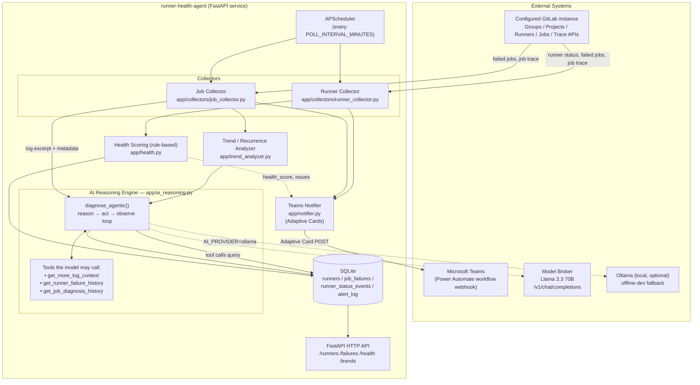
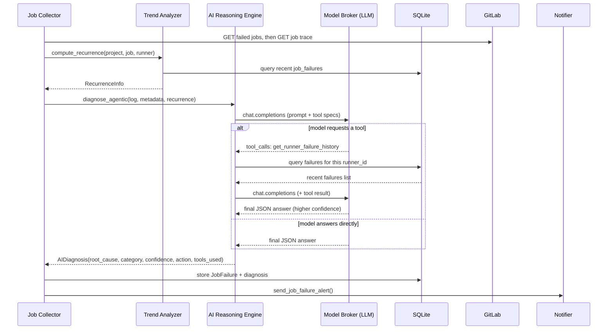
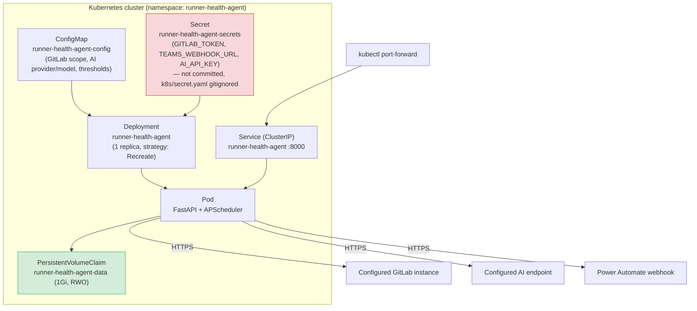

# Architecture — Runner Health Agent (Phase 1 + 2)

This reflects the current implemented state: Phase 1 (Monitoring) + Phase 2
(Diagnostics, including agentic tool-calling). See
[Runner_Health_Agent_MVP.md](Runner_Health_Agent_MVP.md) for the full
roadmap (Phases 3–4 not yet built).

## System / data-flow architecture

## Diagnosis flow detail (the agentic loop)

## Kubernetes deployment topology

### Deployment notes
- `k8s/deploy.ps1` is the one-shot deploy path for the local Docker-Desktop
  cluster: build → import image directly into the node's containerd (works
  without requiring a registry pull) → apply all manifests (including
  `secret.yaml`) → restart → wait for rollout.
- Copy `k8s/configmap.sample.yaml` to `k8s/configmap.yaml` and
  `k8s/secret.sample.yaml` to `k8s/secret.yaml` before deployment.
  Both configured files are private and gitignored.
- For a real cluster (e.g. EKS), the image would instead be pushed to an
  approved registry (ECR/Artifactory) and `deployment.yaml`'s `image:`
  updated accordingly — the local-import step is a Docker-Desktop-specific
  workaround, not a general deployment method.
- SQLite + a single pod (`strategy: Recreate`) is an MVP simplification;
  moving to Postgres would be needed before running multiple replicas.
